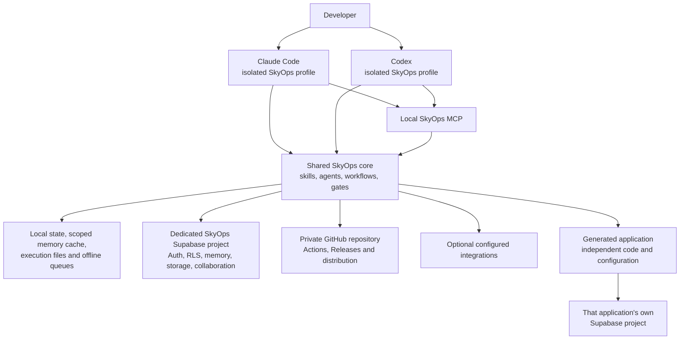

# SkyOps Framework — Complete Transformation Plan

**Prepared:** 26 November 2026  
**Author:** Hasan-Jahouse  
**Organization:** Nexus-AI  
**Website:** https://hasan-99.github.io/Nexus-AI/  
**Audited repository:** https://github.com/hasan-99/copilotops-claude.git  
**Audited commit:** `0cd3dd5c903767de55c86d3661ad36148307afd8`  
**Approved destination:** `hasan-99/SkyOps-Framework` — private; created after explicit user selection because the original candidate already existed  
**Approval status:** APPROVED — including all refinements in Sections 21–28.  
**Source permission status:** CLEARED BY OWNER ATTESTATION — see Section 29.  
**Implementation branch:** `skyops/transformation`  
**Authority:** This document is the authoritative source of truth for the transformation. Scope changes require explicit user approval.

**Latest finalized licensing policy:** **2 active devices per user**, configurable by the Framework Owner; **maximum 24-hour signed license validity**, replacing the former seven-day policy. Validate at every online startup, automatically revalidate/renew during active sessions, and require online validation after expiry. Permanent revocation permits safe official uninstallation only with explicit installation-time consent. See Section 31. **Current position:** Phases 0–1 completed within their recorded scope; Phase 2 in progress; Phases 3–8 pending. Phase 2 is not finalized.

The user explicitly approved this complete technical plan and confirmed ownership and the necessary rights to modify, reuse, rebrand, and develop the original source into SkyOps under Nexus-AI. Implementation is authorized in phase order. Third-party materials remain governed by their own applicable licenses and attribution requirements.

The recommended architecture is **one shared, local-first SkyOps core**, native Claude Code and Codex adapters, GitHub for source control and delivery automation, and one internal Supabase project for authenticated collaboration and memory.

The plan excludes ERP, portals, administrative dashboards, employee monitoring, Vercel, and Railway. The separate .NET SkyOps project is outside scope and must not be used, modified, merged, replaced, or depended upon.

**Technical approval and the original-source permission gate are satisfied.** Progress, evidence, and remaining setup dependencies are tracked in Sections 28–33. No completion or performance claim is valid without the corresponding evidence.

## 1. Scope and evidence

The audited baseline is commit `0cd3dd5c903767de55c86d3661ad36148307afd8`.

| Evidence category | Current finding |
| --- | --- |
| Repository inventory | 320 tracked entries: 319 files and one Git submodule reference |
| Readable source | 317 text files; two binary/generated files |
| Agents | 9 named agent definitions, plus specialist roles embedded in workflow prompts |
| Skills | 29 definitions; 28 entries in the active command manifest |
| Runtime helpers | 41 files |
| Hooks | 15 JavaScript hooks and one bypass copy |
| Templates | 88 files |
| Design system | 8 documents |
| Rules | 13 documents |
| Syntax checks | 71 JavaScript, 24 JSON, and 3 Python files passed |
| Original functional tests | Referenced suites are missing |
| Functional parity | Not yet established |

These checks are the recorded audit results. They are not a claim that the framework's complete functionality has been executed or verified.

The plan uses four classifications:

| Classification | Meaning |
| --- | --- |
| **Preserved** | Existing implementation retained and adapted |
| **Reconstructed** | Missing implementation built from available contracts, references, and call sites |
| **New requirement** | Functionality required by the specification but not established in the snapshot |
| **Excluded** | ERP, portal, monitoring, hosting integrations, or historical private data explicitly rejected |

Passing reconstructed-component tests will establish compliance with their specified contracts. It will **not** be presented as proof of identical behavior inside unavailable upstream systems.

All existing development-related agents, skills, internal roles, commands, workflows, execution steps, orchestration, planning methods, design systems, templates, testing, verification, repair, deployment preparation, and maintenance capabilities must be preserved, except for the explicitly approved exclusions and adaptations documented here.

## 2. Target architecture

The architectural boundaries are:

- **Shared core:** one implementation of each agent, skill, workflow, state transition, and validation rule.
- **Host adapters:** translate configuration, invocation, hook payloads, permissions, and agent registration for each supported host.
- **Local MCP:** exposes authorized memory, context, coordination, and integration tools. It normally runs over local standard input/output, without a public listening server.
- **Supabase:** holds internal SkyOps identities, memberships, authorized memory, collaboration records, and private storage.
- **GitHub:** holds source, CI/CD configuration, signed release packages, and development artifacts.
- **Generated applications:** have separate Supabase projects, credentials, authentication, storage, and migrations.

Framework infrastructure will not require an always-running application server, web dashboard, or additional hosting provider.

All SkyOps users and teams use the dedicated internal Supabase project with strict logical isolation. Generated application data must never be mixed with internal framework data.

## 3. Deployment after removing Vercel and Railway

`/sky-ship` remains a complete delivery workflow with quality gates. Its evidence requirements depend on the selected target.

| Target | Supported outcome | Required evidence |
| --- | --- | --- |
| Local application | Running full-stack application on an authorized local machine | Startup, health, authentication, and relevant user-flow checks |
| GitHub Release | Versioned production build or deployment package | Successful checks, artifact hashes, version, provenance, and release receipt |
| GitHub Pages | Published compatible static application | Static export checks, intended visibility, reachable URL, browser verification |
| Application Supabase project | Database, storage policies, and supported Edge Functions deployed | Correct project reference, applied migrations, RLS tests, function smoke tests |
| Deployment preparation | Runnable application package and documented deployment procedure | Reproducible build, configuration contract, startup instructions, verification commands |

**A release artifact must not be recorded as a live deployment.** State distinguishes `release_url`, `deployed_url`, delivery target, and verification evidence.

Full Next.js server functionality remains available locally and in runnable build artifacts. GitHub Pages is static hosting; Supabase Edge Functions have bounded execution limits. Neither is represented as a general-purpose Next.js server host. Long-running workers retain local execution and packaging support.

References: [GitHub Pages](https://docs.github.com/en/pages/getting-started-with-github-pages/what-is-github-pages), [Supabase function limits](https://supabase.com/docs/guides/functions/limits).

GitHub Actions supports testing, building, packaging, releasing, and approved deployment of Supabase resources. A project may supply an explicit deployment command for an independently managed target, without introducing another mandatory hosting integration.

Vercel and Railway integrations, configuration requirements, runtime dependencies, and deployment assumptions are removed from active framework files. Legally required third-party notices are preserved.

## 4. Identity and naming

### Confirmed identity

- **Framework name:** SkyOps
- **Display name:** SkyOps Framework
- **Slug:** `skyops`
- **Assistant command prefix:** `sky-`
- **Framework environment-variable prefix:** `SKYOPS_`
- **Author:** Hasan-Jahouse
- **Organization:** Nexus-AI
- **Website:** https://hasan-99.github.io/Nexus-AI/
- **Tagline:** From Idea to Production.
- **Description:** SkyOps is an AI-powered software engineering framework for the complete development lifecycle, from idea, requirements, planning, and UI/UX design to architecture, implementation, testing, deployment, and maintenance.

| Existing identity | Target |
| --- | --- |
| Qualia Framework | SkyOps Framework |
| Organization branding | Nexus-AI |
| Author metadata | Hasan-Jahouse |
| Framework tagline | From Idea to Production. |
| `qualia-*` assistant commands | `sky-*` |
| Root `/qualia` router | Proposed `/sky-next`, preserving its routing responsibility |
| `deep-research` | `sky-deep-research` |
| `zoho-workflow` | `sky-zoho-workflow` |
| Framework executable/package metadata | `skyops`; private, without npm publication |
| `QUALIA_*` framework variables | `SKYOPS_*` |
| `qualiaHome()` and corresponding internal identifiers | SkyOps equivalents |
| `qualia-design/` | `skyops-design/` |
| `qualia-templates/` | `skyops-templates/` |
| `qualia-references/` | `skyops-references/` |
| `.planning/qualia/` | `.planning/skyops/` |
| Qualia MCP namespaces | SkyOps-native namespaces |
| Company defaults in payloads | Explicit authenticated user/workspace/project identifiers |

Host-required names such as `CLAUDE.md`, `AGENTS.md`, `CODEX_HOME`, and native configuration filenames retain their required meanings.

Legally required attribution and reviewed provenance may retain original names. Active runtime identity, update sources, configuration, and network dependencies use SkyOps.

The new installation root is isolated, provisionally `~/.skyops-framework/`. It contains versioned releases and separate host/user profiles. It must not use the existing .NET SkyOps installation or cache.

### Branding requirements

Design a new independent SkyOps logo consistent with Nexus-AI, using the proposed palette:

| Role | Color |
| --- | --- |
| Primary | `#2563EB` |
| Secondary | `#06B6D4` |
| Dark | `#0F172A` |
| Light | `#F8FAFC` |

The logo must be modern, professional, minimal, recognizable, and support light and dark themes. Provide SVG and PNG assets. Present the proposed logo and branding for separate approval before finalizing them.

Framework rebranding must preserve all original UI/UX design intelligence, templates, design workflows, scoring, and systems. SkyOps branding must not be forced onto generated applications; each application keeps its own independent identity.

### Language requirements

English is authoritative for source code, agents, skills, internal skills, commands, system prompts, workflow instructions, configuration, technical/API documentation, comments, and default CLI output/help.

Provide English and Arabic user guides, installation guides, getting-started guides, usage examples, and troubleshooting guides. Arabic documentation must support proper RTL layout.

Users may communicate in their preferred language. Do not duplicate internal prompts, agents, or workflows solely for translation.

## 5. Multi-user and authorization model

SkyOps treats identities and permissions as separate concepts:

- Supabase Auth establishes the user's identity.
- Database membership and ownership records establish cloud authorization.
- Local operating-system permissions protect local profiles and credential stores.
- Claude Code and Codex logins do not automatically establish a SkyOps cloud identity.
- Environment variables and model-provided role names cannot grant cloud privileges.

| Role | Authorized responsibility | Boundary |
| --- | --- | --- |
| Framework Owner | Framework configuration, releases, authorized shared knowledge publication | No automatic access to personal memory or private project contents |
| Workspace Owner | Workspace ownership, invitations, membership and ownership transfer | Limited to that workspace |
| Workspace Admin | Delegated workspace administration | Cannot create Framework Owners or silently take over private projects |
| Member | Work in authorized workspaces and projects | Membership does not expose unrelated private projects |
| Project Owner | Project sharing, permissions, configuration and lifecycle | Limited to owned projects |
| Viewer | Read explicitly authorized resources | No modification, credential use, or permission changes |

Additional safeguards:

- Every cloud user receives a private profile and personal workspace.
- Users may own multiple workspaces and projects.
- Teams belong to workspaces; users may join multiple teams and workspaces.
- Projects support private ownership, direct membership, and explicit team grants.
- Removing access takes precedence over inherited grants.
- Ownership transfers are transactional.
- The last owner cannot accidentally leave a resource ownerless.
- Framework roles cannot be obtained through ordinary invitations.
- Personal memory sharing requires explicit authorization.
- Database administrators remain trusted infrastructure operators; application-level isolation does not conceal data from a database superuser.

The original blanket OWNER restriction on curated recall is adapted explicitly: framework-wide curation remains privileged, while users can retrieve their own authorized personal, team, and project memory.

Each user must have a unique account, authentication, profile, personal workspace, memory, knowledge, project history, preferences, private projects, execution history, and secure integration configuration. These are mandatory first-release requirements.

## 6. Authentication and secure sessions

The first release supports:

- Email login, with email OTP as the initial CLI-friendly path.
- GitHub OAuth.
- Secure refresh/session handling.
- Logout and session/device revocation.
- Account/profile management through CLI and secure backend operations.
- Independent host installation, with shared SkyOps identity when both hosts are used.

GitHub login uses PKCE and an approved loopback callback flow. Any temporary local callback listener exists only during authentication.

Refresh tokens use operating-system credential storage where available. Protected local storage is documented where a platform requires a fallback. Tokens must not be placed in prompts, command arguments, source control, or ordinary logs.

Supabase supports email OTP and GitHub authentication; GitHub OAuth requires operator configuration in the dedicated Supabase project. References: [Email authentication](https://supabase.com/docs/guides/auth/auth-email-passwordless), [GitHub authentication](https://supabase.com/docs/guides/auth/social-sign-in/auth-github).

**Email delivery dependency:** production email login needs configured SMTP. Supabase's default mail service is restricted and intended for development. The already-approved Zoho Mail capability can provide Nexus-AI-controlled SMTP, subject to account configuration. This adds no hosting platform and is not required for local installation. Reference: [Supabase SMTP requirements](https://supabase.com/docs/guides/auth/auth-smtp).

Authentication is required for cloud-backed personal, team, workspace, and project resources. Under the subsequently approved licensing requirements, initial framework installation also requires an invited individual account, Framework Owner approval, an active license, and server-authorized device activation. After authorized activation, local/offline execution is available within the signed license window. Generated-application cloud configuration and optional integrations remain separate.

## 7. Proposed Supabase schema

The dedicated project uses an application schema such as `skyops`, with privileged helpers in a non-exposed schema. Supabase-managed `auth` and `storage` schemas remain vendor-managed.

UUIDs identify users and resources. Mutable synchronized resources carry a revision/version. Scoped foreign keys prevent records from linking resources across workspaces or projects.

| Table | Principal fields and purpose |
| --- | --- |
| `profiles` | `user_id → auth.users`, display identity, account lifecycle metadata |
| `user_settings` | Private preferences, language, privacy and retention preferences |
| `framework_roles` | Controlled Framework Owner assignments |
| `workspaces` | ID, owner, personal/shared kind, name, lifecycle status |
| `workspace_members` | Workspace/user composite key, role, active/revoked status |
| `teams` | Team ID, workspace ID, name and scoped ownership |
| `team_members` | Team/workspace/user relationship and membership status |
| `projects` | ID, workspace, owner, visibility, repository metadata, application Supabase reference |
| `project_members` | Direct project permissions and explicit revocation |
| `project_team_grants` | Team access to a project within the same workspace |
| `invitations` | Scoped invitation, intended identity, requested role, token hash, expiry, acceptance |
| `memory_documents` | Scope, owning resource, title, classification, current revision, retention/deletion status |
| `memory_revisions` | Versioned document content, provenance and authorized authorship |
| `memory_chunks` | Document/revision references, text-search index, embedding profile and vector |
| `memory_grants` | Explicit additional sharing, including authorized personal-memory sharing |
| `knowledge_promotions` | Proposed publication into shared knowledge and required approvals |
| `project_artifacts` | Versioned requirements, plans, contracts, design context and verification references |
| `tasks` | Project-scoped tasks, execution state and revision |
| `task_dependencies` | Project-scoped dependency edges |
| `task_claims` | Online coordination leases, actor/device and expiry |
| `execution_runs` | User/project-scoped execution records, parent runs, outcomes and optional metrics |
| `project_events` | Append-only development events, state references and integrity metadata |
| `sync_operations` | Operation ID, actor/device, base revision, result and conflict status |
| `devices` | User-owned device/session registration and synchronization cursor |
| `artifact_objects` | Authorized ownership and Storage-object metadata |
| `integration_configs` | Scoped configuration and opaque credential references |
| `retention_policies` | Personal/workspace/project retention settings |
| `deletion_tombstones` | Prevent stale offline operations from restoring deleted content |

This is development coordination data. It contains no ERP entities, employee scoring, payroll, billing engine, or administrative dashboard model.

Generated-application database contents, authentication records, storage objects, and service keys must not be stored in this framework database. Application references and development context may be recorded as authorized project metadata.

## 8. Memory and knowledge architecture

| Memory level | Access model | Publication behavior |
| --- | --- | --- |
| Framework knowledge | Authorized framework users; controlled maintainers write | Reviewed technical content only |
| Personal memory | Owner, plus explicitly authorized grants | Private by default |
| Team/workspace memory | Authorized membership in the relevant scope | Shared only inside that scope |
| Project memory | Project ownership, membership or explicit team grant | Bound to the project |

The retrieval path is:

**Authenticated scope → authorized document candidates → keyword/vector search → authorized content → bounded agent context with citations.**

Authorization runs inside database queries and search functions. SkyOps must not retrieve a global result set and rely on an agent to remove unauthorized results afterward. Supabase supports permission-aware vector retrieval using PostgreSQL RLS. Reference: [Permission-aware retrieval](https://supabase.com/docs/guides/ai/rag-with-permissions).

Semantic search uses:

- A local embedding adapter by default, loaded when needed.
- A pinned, licensed multilingual model and compatible ONNX artifact.
- A candidate model profile based on `paraphrase-multilingual-MiniLM-L12-v2`, whose publisher identifies it as multilingual and Apache-2.0 licensed.
- Explicit embedding model/version/dimension metadata.
- Separate indexing or re-indexing when embedding profiles change.
- Optional configured hosted embedding adapters, with disclosure before content is transmitted.

The actual model artifact, license, resource usage, and Windows/Linux/macOS compatibility must pass the dependency gate before release. Reference: [Publisher model card](https://huggingface.co/sentence-transformers/paraphrase-multilingual-MiniLM-L12-v2).

Memory safeguards include:

- No automatic promotion from private memory into framework knowledge.
- Explicit publication review and source-scope authorization.
- Cache keys bound to user, workspace, project, model profile and authorization context.
- Fresh task context when switching projects or users.
- Configurable retention and deletion, including embeddings and cached results.
- No import of original user history, client information, private logs or credentials.
- Generic technical knowledge admitted only after permission, content and privacy review.
- Shared context between Claude Code and Codex for the same authenticated SkyOps user.
- Persistent memory, session recovery, cross-session learning, and context isolation.

## 9. RLS, Storage and synchronization

RLS covers every exposed application table. Grants, functions, views and Storage policies are reviewed together; enabling RLS alone is not the complete authorization model. Reference: [Supabase RLS guidance](https://supabase.com/docs/guides/database/postgres/row-level-security).

| Resource | Policy requirement |
| --- | --- |
| Personal settings and memory | Owner or explicit grant |
| Workspace resources | Current membership and permitted action |
| Team resources | Current workspace and team authorization |
| Private projects | Project-specific authorization |
| Memory chunks and revisions | Authorization inherited from the live parent document |
| Tasks and artifacts | Authorization inherited from their project |
| Membership/ownership changes | Validated transactional operations |
| Shared framework knowledge | Authenticated read; controlled publication |
| Integration configuration | Scoped visibility; secrets excluded from ordinary reads |
| Events | Authorized append; no ordinary mutation of existing integrity records |

Storage uses private buckets and ownership metadata linked to the same permission model. Upload, download, list, overwrite, move, delete and signed-URL creation are each tested. Public buckets must not hold private memory or project artifacts. Reference: [Storage access control](https://supabase.com/docs/guides/storage/security/access-control).

Offline behavior:

- Existing local execution files remain usable.
- Synchronization queues are partitioned by identity and resource scope.
- Every replayed operation is reauthorized.
- Version checks replace silent last-write-wins behavior.
- Conflicting edits remain recoverable.
- Deletion tombstones defeat stale resurrection.
- Cloud task claims are transactional and lease-based.
- Offline work does not claim global exclusivity it cannot establish.

**Revocation limitation:** previously downloaded information cannot be remotely "unread." Shared cloud-memory retrieval fails closed when authorization cannot be refreshed, and logout/revocation invalidates applicable caches. Local execution can continue with local project files under operating-system access controls.

## 10. File-by-file change manifest

The following tables define the planned changes. Brace lists apply independently to each named file; directory mappings preserve descendant paths. The implementation manifest records every audited file's disposition, target path, capability IDs and validation evidence.

### Root files and runtime metadata

| Existing file | Planned change |
| --- | --- |
| `package.json` | SkyOps identity, private executable metadata, scripts, pinned dependencies and test commands; no npm publication |
| `CLAUDE.md` | Generated Claude guidance from the shared authoritative instructions |
| `CLAUDE.md.bak.*` — four files | Exclude historical installation backups from the new runtime/distribution; retain audited provenance separately where permitted |
| `SOUL.md` | Confirmed SkyOps identity and architecture |
| `FLAGS.md` | Preserve supported flags, update names and reconcile stale references |
| `qualia-guide.md` | `skyops-guide.md`; English guide with Arabic user-guide counterpart |
| `TROUBLESHOOTING.md` | Update runtime paths and diagnostics; add Arabic user-facing version |
| `CHANGELOG.md` | Separate verified SkyOps changes from reviewed upstream history |
| `agents-skills-guide.html` | Rebrand documentation viewer; preserve workflow explanations |
| `statusline-command.sh` | Isolated paths and portable invocation of the shared status implementation |
| `.gitignore` | Protect profiles, secrets, caches, queues, user memory and generated execution files |
| `.claudeignore` | Updated exclusion rules for the isolated Claude installation |
| `.qualia-config.json` | Safe SkyOps configuration example; original personal installation values excluded |
| `.qualia-install-health.json` | Regenerated SkyOps-owned health state; original state excluded |
| `.qualia-last-update-check` | Regenerated SkyOps update metadata |
| `.qualia-update-available.json` | Private GitHub release update metadata |
| `.last-cleanup` | New installation-owned cleanup state |

### Agents

Agent filenames remain generic; internal names and references become SkyOps names.

| File under `agents/` | Responsibility retained |
| --- | --- |
| `researcher.md` | Evidence-based research and source/tool discipline |
| `research-synthesizer.md` | Combine research, retain conflicts and source attribution |
| `roadmapper.md` | Journey, requirements and milestone planning |
| `planner.md` | Executable tasks, dependencies, acceptance criteria and contracts |
| `plan-checker.md` | Coverage, specificity, dependency and scope-reduction checks |
| `builder.md` | Scoped implementation, validation, commits and deviation reporting |
| `verifier.md` | Goal-backward and wiring verification with evidence |
| `qa-browser.md` | Real-browser, responsive, user-flow and accessibility checks |
| `visual-evaluator.md` | Screenshot-based design evaluation |

Embedded specialist roles in skills and their `REFERENCE.md` files are also retained. The nine named files are not the entire orchestration inventory.

### Runtime helpers — all 41 files

| File under `bin/` | Planned change |
| --- | --- |
| `host-adapters.js` | Isolated native host configuration, capabilities and invocation adapters |
| `command-surface.js` | SkyOps command mapping; preserve historical deprecation metadata |
| `runtime-manifest.js` | Complete owned-file installation manifest |
| `qualia-ui.js` | Rename to `skyops-ui.js`; framework branding and accurate delivery/status output |
| `state.js` | Preserve both state layouts, recovery, claims and lifecycle; add scoped identity and target-specific delivery evidence |
| `state-ledger.js` | SkyOps path, retained integrity semantics, scoped event metadata |
| `plan-contract.js` | Preserve schema, dependency, overlap and scope-reduction validation |
| `contract-runner.js` | Preserve deterministic evidence execution |
| `wave-plan.js` | Preserve dependency-derived scheduling and concurrency limits |
| `batch-plan.js` | Preserve isolated batch/worktree migration lane |
| `agent-status.js` | Preserve status protocol and completion barriers |
| `agent-runs.js` | User/project-scoped development telemetry; privacy controls |
| `analyze-gate.js` | Preserve requirements-to-plan and glossary checks |
| `verify-panel.js` | Preserve deduplication, skeptic voting and deterministic verdicts |
| `eval-runner.js` | Preserve deterministic assertions and unresolved-judge failure behavior |
| `harness-eval.js` | Preserve framework/project evidence scoring |
| `trust-score.js` | Replace ERP/hosting checks with applicable local, GitHub, MCP and Supabase checks |
| `security-scan.js` | New namespaces, scoped secrets/configuration checks, removed hosting assumptions |
| `slop-detect.mjs` | Preserve design-quality rules and thresholds |
| `design-tokens.js` | Preserve project-specific token generation; no forced SkyOps application branding |
| `repo-map.js` | Preserve supported language mapping and indexing |
| `knowledge.js` | Scope-aware local/shared knowledge access |
| `recall.js` | Authorized multi-level retrieval and semantic-search entrypoint |
| `vault-access.js` | Explicit authorization boundary and fail-closed behavior |
| `knowledge-flush.js` | Scoped learning consolidation; controlled promotion |
| `learning-candidates.js` | Authorized local/project sources only |
| `last-report.js` | Scoped report continuity |
| `report-payload.js` | Local development report format; remove employee/ERP assumptions |
| `auto-report.js` | Local release/development report capture with optional synchronization |
| `erp-retry.js` | Replace with `sync-queue.js`, preserving durable retry/deduplication behavior |
| `erp-event.js` | Replace with `development-events.js`; remove ERP transport and endpoints |
| `work-packet.js` | Local/MCP/Supabase task-context reader; no ERP pull |
| `project-snapshot.js` | Scoped local snapshots and optional synchronization |
| `project-sync.js` | Conflict-aware development-state synchronization |
| `branch-hygiene.js` | Preserve branch/PR checks with explicit repository context |
| `planning-hygiene.js` | Preserve planning-file organization and safe routing |
| `prune-deprecated.js` | Operate exclusively on new SkyOps-owned installation files |
| `codex-goal.js` | Preserve native Codex objective support |
| `status-snapshot.js` | Accurate local/cloud/queue health; repair the existing queue-layout mismatch |
| `statusline.js` | Scoped English-default status output |
| `clean-temp-images.ps1` | Cleanup restricted to owned artifact paths |

### Hooks

| Existing file under `hooks/` | Planned change |
| --- | --- |
| `auto-update.js` | Private GitHub release checks and explicit update execution |
| `branch-guard.js` | Preserve documented development accountability locally; remove ERP reporting |
| `env-empty-guard.js` | Validate applicable project/integration environments |
| `fawzi-approval-guard.js` | Rename to `approval-guard.js`; identity-independent authorization checks |
| `git-guardrails.js` | Preserve destructive-command protections |
| `migration-guard.js` | Preserve migration checks and distinguish framework/application targets |
| `pre-compact.js` | Scoped session recovery snapshots |
| `pre-deploy-gate.js` | Target-aware build, test, security and delivery gates |
| `pre-deploy-gate.js.bypass` | Reviewed provenance/test material; never installed as an active weaker guard |
| `pre-push.js` | Preserve local commit/push tracking |
| `session-start.js` | Load authorized context and queue status |
| `stop-session-log.js` | Scoped continuity records, configurable development metrics |
| `supabase-destructive-guard.js` | Preserve destructive-operation protection and add project-reference isolation |
| `task-write-guard.js` | Preserve declared-file enforcement and validate active task context |
| `usage-capture.js` | Raw prompt capture off by default; remove employee performance auditing |
| `vercel-account-guard.js` | Replace with `deployment-target-guard.js` for repository, Supabase project and environment selection |

Host-specific hook input/output is normalized at the adapter boundary. Critical failures must block the appropriate operation; informational hooks retain their intended behavior.

### Skills and command parity

Each row maps `skills/<old>/SKILL.md` to `skills/<new>/SKILL.md`. All current statuses are **planned; functional validation not run**.

| Original skill | SkyOps skill | Required preservation/acceptance |
| --- | --- | --- |
| `qualia` | `sky-next` | Same state-driven next-action routing |
| `qualia-new` | `sky-new` | Discovery, research, project types and journey setup |
| `qualia-scope` | `sky-scope` | Project/phase/increment intake and acceptance criteria |
| `qualia-map` | `sky-map` | Existing-codebase mapping and onboarding |
| `qualia-research` | `sky-research` | Evidence-based phase research |
| `deep-research` | `sky-deep-research` | All specialist research lanes and synthesis |
| `qualia-plan` | `sky-plan` | Planner/checker cycles and machine contracts |
| `qualia-build` | `sky-build` | Fresh builders, waves, barriers and batch lane |
| `qualia-feature` | `sky-feature` | Inline/spawn/scope routing |
| `qualia-fix` | `sky-fix` | Root-cause, repair and feedback-loop modes |
| `qualia-verify` | `sky-verify` | Machine evidence, panel, skeptic and browser verification |
| `qualia-eval` | `sky-eval` | AI-feature assertions, judges and failure gates |
| `qualia-review` | `sky-review` | Security, quality and performance review |
| `qualia-secure` | `sky-secure` | Agent/configuration security review |
| `qualia-test` | `sky-test` | Test generation, execution, coverage and TDD |
| `qualia-polish` | `sky-polish` | Every scope, visual loop, vibe/extract/sync mode and budget guard |
| `qualia-optimize` | `sky-optimize` | Specialist discovery, alignment and interface-design alternatives |
| `qualia-milestone` | `sky-milestone` | Closeout, archive, requirements and next milestone |
| `qualia-update` | `sky-update` | Post-launch maintenance workflow |
| `qualia-ship` | `sky-ship` | Full gates and truthful target-specific delivery |
| `qualia-handoff` | `sky-handoff` | Documentation, archive and verified completion without ERP |
| `qualia-report` | `sky-report` | Development reports, local history and optional sync |
| `qualia-doctor` | `sky-doctor` | Installation, state, contracts, memory and configured integrations |
| `qualia-road` | `sky-road` | Complete workflow map |
| `qualia-idk` | `sky-idk` | Isolated diagnostic scans and actionable guidance |
| `qualia-learn` | `sky-learn` | Authorized scoped learning |
| `qualia-recall` | `sky-recall` | Authorized retrieval and privileged framework curation |
| `qualia-postmortem` | `sky-postmortem` | Failure analysis, proposed improvements and learning |
| `zoho-workflow` | `sky-zoho-workflow` | Optional direct Zoho Books/Mail operations |

Additional skill files:

| Existing files | Planned change |
| --- | --- |
| `qualia-{new,optimize,polish}/REFERENCE.md` | Preserve all detailed prompts and orchestration; update references |
| `qualia-polish/scripts/loop.mjs` | Preserve iteration, regression and token-budget controls |
| `…/playwright-capture.mjs` | Preserve capture backends; repair portable browser discovery |
| `…/score.mjs` | Preserve nine-dimension scoring |
| `…/vibe-extract.mjs` | Repair the capture/output contract mismatch |
| `…/vibe-tokens.mjs` | Preserve token conversion/synchronization |
| `qualia-polish/fixtures/{broken,clean}.html` | Retain meaningful design regression fixtures |

The 17 retired names remain migration/deprecation metadata with their documented current routes. Missing historical implementations must not be falsely labelled working.

### Design, rules and references

| File set | Planned change |
| --- | --- |
| All eight `qualia-design/{design-brand,design-dials,design-laws,design-product,design-reference,design-rubric,frontend,graphics}.md` | Move individually to `skyops-design/`; preserve design intelligence, scoring and workflows |
| `rules/{access,security,trust-boundary}.md` | Multi-user permissions, secrets, memory and prompt-injection boundaries |
| `rules/{constitution,deployment,infrastructure}.md` | Updated infrastructure and equivalent target-aware gates |
| `rules/{architecture,grounding,speed,command-output,one-opinion,context7,codex-goal}.md` | Preserve engineering methods; update identity and references |
| `references/archetypes/{ai-agent,voice-agent,web-app,website}.md` | Preserve archetype-specific completion criteria |
| `references/questioning.md` | Preserve intake methods |
| `qualia-references/questioning.md` | Preserve separately under `skyops-references/`; no silent consolidation |

### All 88 template files

Every file moves from `qualia-templates/` to `skyops-templates/` at the same relative path.

| Template files | Planned change |
| --- | --- |
| `{CONTEXT,DESIGN,PRODUCT}.md` | Preserve domain, design and product contracts |
| `{journey,phase-context,plan,project-discovery,project,requirements,roadmap,state,work-packet}.md` | Preserve structures and workflow semantics; remove ERP/hosting assumptions |
| `instructions.md` | Authoritative English instructions for both hosts |
| `help.html` | Rebranded framework help |
| `planning.gitignore` | Protect local state and private execution data |
| `tracking.json` | Preserve development counters; add scoped identity and delivery evidence |
| `decisions/ADR-template.md` | Preserve decision record structure |
| `projects/{ai-agent,mobile-app,voice-agent,website}.md` | Preserve project planning capabilities; adapt delivery methods |
| `research-project/{ARCHITECTURE,FEATURES,PITFALLS,STACK,SUMMARY}.md` | Preserve research contracts |
| `stacks/README.md` | Explain independent application infrastructure |
| Each stack's `{env.required.json,phases.md,stack.json,verify-checklist.md}` | Remove hosting accounts; preserve capabilities and independent Supabase requirements |
| Each scaffold's `{README.md,package.json,tsconfig.json,next.config.mjs,postcss.config.mjs}` | Runnable local build, compatible lint/test configuration and target-specific delivery |
| Each scaffold's `app/{globals.css,layout.tsx,page.tsx}` | Preserve starter functionality and project-owned visual identity |
| Three application scaffolds' `lib/supabase/{client,server}.ts` | Preserve separate application authentication and configuration |
| Three application scaffolds' `supabase/migrations/0001_init.sql` | Preserve application data patterns; add explicit security validation |
| AI scaffold `app/api/chat/route.ts` | Preserve real integration; validate authentication/error-handling requirements before production acceptance |
| AI scaffold `lib/openrouter/client.ts` | Preserve configurable model/fallback behavior |
| AI scaffold `lib/prompts/system.ts` | Preserve source-controlled application instructions |
| AI scaffold `evals/cases.json` | Preserve measurable AI acceptance criteria |

The four stacks remain landing page, full application, internal tool and AI agent. Existing Next.js, React, TypeScript, Tailwind, Supabase and Zod capabilities remain. Hosting coupling is removed.

Starter templates remain labelled as starters; they must not be presented as completed applications. The lint gate uses a supported executable rather than the removed `next lint` command. Reference: [Next.js migration guidance](https://nextjs.org/docs/app/guides/upgrading/version-16).

### Scripts, knowledge and remaining files

| Existing file set | Planned change |
| --- | --- |
| `scripts/{apply-retention,cleanup}.sh` | Scoped retention/cleanup; portable shared implementations where needed |
| `scripts/bootstrap-pop-os.sh` | Optional Linux setup; remove rejected hosting dependencies |
| `scripts/claude-voice` | Optional voice launcher with safe configuration |
| `scripts/cowork-mode.sh` | Preserve lightweight runtime switching within isolated profiles |
| `scripts/generate-project-claude-md.sh` | Use the shared instruction compiler |
| `scripts/load-test-webhook.js` | Preserve controlled load-testing capability |
| `scripts/{say,speak}.py`, `scripts/speak.sh` | Preserve optional speech output |
| `scripts/voice-hotkey.py`, `scripts/voice-input.sh` | Preserve Linux/Wayland behavior; remove hardcoded credentials and configure devices |
| `scripts/status.sh` | Preserve terminal status through shared core |
| `scripts/sync-to-framework.sh` | Safe synchronization into the new private source/release workflow |
| `scripts/showcase-video-recorder/{ffmpeg-builder,playwright-helpers}.js` | Preserve video and browser helpers |
| `scripts/__pycache__/say.cpython-314.pyc` | Exclude generated binary; retain its Python source |
| `knowledge/{agents,claudecode-bible,common-fixes,index,learned-patterns,supabase-patterns,voice-agent-patterns}.md` | Permission/content review; preserve authorized generic knowledge and structures |
| `knowledge/daily-log/*.md` — 49 files | No import into new users or distribution |
| `knowledge/{client-prefs.md,deployment-map.md,email-signature.html,.claude.lnk}` | No import of private/client/install-specific information |
| `plugins/known_marketplaces.json` | New isolated configuration; no copied old installation paths |
| Official marketplace submodule reference | No inherited cache or unreviewed bundled dependency; preserve optional native plugin capability |
| `teams/default/inboxes/plan-04.json` | Do not import historical session payload; reconstruct protocol with independent test fixtures |

## 11. New and reconstructed components

These additions use the existing runtime helpers wherever possible.

| Proposed files/modules | Purpose | Classification |
| --- | --- | --- |
| `bin/skyops.js` | Main CLI and existing helper routing | Reconstructed |
| `lib/{paths,config,identity,host-runtime}.js` | Isolated runtime configuration | Preserved + new |
| `lib/{auth,credential-store,scopes,authorization}.js` | Identity, secure sessions and scoped backend calls | New |
| `lib/{memory,search,embeddings,context}.js` | Multi-level memory and authorized retrieval | New + reconstructed |
| `lib/{sync,conflicts,coordination}.js` | Offline replay, revision conflicts and claims | New + preserved queue behavior |
| `lib/{integrations,delivery}.js` | Optional provider configuration and target-aware delivery | Preserved + new |
| `bin/{install,configure,update,uninstall}.js` | Independent lifecycle and owned-file receipts | Reconstructed |
| `bin/compile-instructions.js` | Generate both native host configurations | Reconstructed |
| `install.ps1`, `install.sh` | PowerShell/Bash/Zsh entrypoints | Reconstructed |
| `mcp/skyops/server.mjs` | Local scoped MCP interface | Reconstructed |
| `contracts/{capabilities,configuration,permissions,mcp-tools}.json` | Explicit interfaces and acceptance inventory | New |
| `supabase/config.toml` and ordered migrations | Internal SkyOps database deployment | New |
| Narrow Supabase Edge Functions | Privileged operations only where SQL/Auth is insufficient | New |
| `tests/{unit,contracts,integration,isolation,hosts,installation,e2e}/` | Automated verification | Reconstructed + new |
| `.github/workflows/{ci,compatibility,release,supabase}.yml` | Private GitHub automation | Reconstructed + new |
| `docs/{en,ar}/` | User, installation, examples and troubleshooting guides | New/adapted |
| `docs/technical/` | English architecture, API and operational documentation | New/adapted |
| `assets/brand/` | Approved SVG/PNG framework assets | New, separate branding approval |
| `docs/audit/` manifests | Per-file disposition, parity evidence and approved exceptions | New |

No ERP server, portal, administrative UI, npm registry or additional AI-platform adapter is created.

## 12. Capability parity tracking

The skill and agent tables above form the command-level matrix. The cross-cutting matrix tracks implementation paths, migration status, test evidence and remaining issues.

| Capability | Original implementation | Target implementation | Validation requirement |
| --- | --- | --- | --- |
| Agent responsibilities | Named files and embedded roles | Same responsibilities, shared English source | Coverage and host execution tests |
| Planning and contracts | Planner/checker, contract helpers | Adapted existing code | Positive/negative contract cases |
| Orchestration | Waves, batches, status barrier, worktrees | Adapted existing code | Dependency, overlap and completion tests |
| Project state | Legacy phases and increments/releases | Both layouts retained | Transition, recovery and migration tests |
| Verification | Contracts, panel, skeptics, browser QA | Same mechanisms | Failed evidence cannot become PASS |
| Repair | Fix, gap closure, postmortem | Same development paths | Reproduce → repair → verify scenarios |
| Design intelligence | Eight documents, scoring and polish loops | Preserved separately from framework branding | Rubric, visual-loop and generated-brand tests |
| Testing | Skills/helpers present; framework suites missing | Reconstructed test surface | Tests tied to actual contracts |
| Delivery | Hosting-specific workflows | Local/GitHub/Supabase targets | Target-specific evidence |
| Reports and continuity | Local files plus ERP coupling | Local records plus optional sync | Works offline without ERP |
| Memory and learning | Local files, role-filtered vault; missing MCP | Scoped local/cloud memory and MCP | Retrieval and isolation tests |
| Multi-user collaboration | Partial identifiers and local roles | Authenticated tenancy and collaboration | New requirement tests |
| Semantic search | Not established in snapshot | Authorized local/cloud search | New requirement tests |
| Optional integrations | Skills, adapters and external tools | Independently configured integrations | Contract and configured live tests |
| Installation/update | Missing CLI/installer | Private, isolated lifecycle | Independent host/OS installation tests |

All implementation rows currently remain **not started**. Original-comparison tests, reconstructed-contract tests, and new-requirement tests have separate results.

The release target is complete coverage of the approved development-capability inventory, with no undisclosed failures or inferred parity claims.

### Integrations retained

Retain modular, configurable support for Supabase, OpenRouter, Retell, ElevenLabs, Telnyx, Zoho Books, Zoho Mail, Context7, NotebookLM, browser tooling, uptime monitoring, and other relevant authorized integrations discovered during implementation.

Integrations activate only when needed. They use user/Nexus-AI-controlled accounts and project-specific configuration, with secure credentials, health checks, error handling, and automated tests. External accounts are not required during initial installation unless technically essential to obtain the private distribution.

## 13. Claude Code and Codex compatibility

| Requirement | Claude Code | Codex |
| --- | --- | --- |
| Authoritative workflow source | Shared English definitions | Same source |
| Top-level guidance | Generated `CLAUDE.md` | Generated `AGENTS.md` |
| Skill registration | Native supported mechanism | Native supported mechanism |
| Agent registration | Native role definitions | Native role configuration |
| Model assignment | Configurable host-supported settings | Configurable host-supported settings |
| Orchestration | Native capabilities retained | Native capabilities retained |
| Hooks | Host-specific input/output adapter | Host-specific input/output adapter |
| Local MCP | Scoped authenticated tools | Same tools and authorization core |
| Memory continuity | Same SkyOps user/resource IDs | Same SkyOps user/resource IDs |
| Host isolation | Dedicated SkyOps configuration root | Dedicated `CODEX_HOME` |
| Other host required | No | No |

Codex and Claude expose different hook contracts. The implementation uses supported command hooks and tests blocking behavior on each host, rather than copying configuration between them.

References: [Codex configuration](https://learn.chatgpt.com/docs/config-file/config-advanced), [Codex hook support](https://learn.chatgpt.com/docs/config-file/config-reference), [Claude hook contracts](https://code.claude.com/docs/en/hooks).

The release compatibility matrix covers:

| Environment | Core/install/uninstall | Host adapters | Optional voice |
| --- | --- | --- | --- |
| Windows + PowerShell | Required | Claude and Codex independently | Not required |
| Linux + Bash | Required | Independently required | Existing Linux implementation |
| macOS + Zsh/Bash | Required | Independently required | Not required |
| WSL + Bash | Required | Validate installed host/environment explicitly | Document device/session limitations |

VS Code is the primary editor, with standalone terminal/CLI support. SkyOps remains editor-independent and requires no custom editor extension. GitHub Copilot, Cursor AI, and other coding-platform integrations are not implemented in the first release.

Negative-discovery tests must prove that the separate .NET SkyOps skills, configuration and cache are not loaded. Any host version that cannot provide the required isolation is reported as unsupported until resolved.

## 14. Security and privacy requirements

Mandatory controls include:

- Raw prompt capture disabled by default.
- No employee performance metrics or monitoring.
- No credentials in prompts, vectors, logs, releases or source.
- Per-user credential storage and project-specific application secrets.
- Scoped shared integration configuration with guarded secret use where necessary.
- No application service key supplied to an agent as ordinary context.
- No Framework Owner privilege granted merely because a username matches the author.
- No authorization based on user-editable metadata or local role environment variables.
- Scoped MCP filesystem access, validated tool parameters and controlled integration destinations.
- Existing project-file prompt-injection boundaries retained.
- No automatic promotion of private content into shared knowledge.
- Explicit retention, deletion, cache invalidation and backup limitations.
- No unnecessary telemetry to framework or dependency vendors.
- Application Supabase references must differ from the framework reference.
- Migration/deployment commands must validate their intended project.
- Critical security gates cannot silently degrade into informational warnings.
- Document which data remains local and which data is synchronized.

Identified source defects—such as missing-manifest access behavior, contradictory branch rules, capture-contract mismatches and unsafe credential defaults—receive explicit corrective tests and change records.

## 15. Tests and regression gates

| Test layer | Required coverage |
| --- | --- |
| Unit | Validators, routing, scoring, graph scheduling, state parsing, queue logic |
| Original comparison | Deterministic behavior compared against retained baseline implementations, normalizing approved identity/path changes |
| Contract | CLI interfaces, MCP schemas, report formats, integrations, errors and exit codes |
| State/recovery | Interrupted writes, journals, contention, migration/revert, claims and lifecycle |
| Installation | Fresh install, repeat install, update, rollback, partial failure and owned-file uninstall |
| Native hosts | Independent Claude/Codex execution, hook enforcement, agent tools and profile isolation |
| Database | Actual PostgreSQL constraints, grants, RLS and transactional operations |
| Memory | Scoped search, citations, revisions, deletion, promotion and cache behavior |
| Browser/design | Responsive layouts, accessibility, real user flows, visual scoring and loop controls |
| Delivery | Correct target, configuration, artifacts, evidence and truthful status |
| Integrations | Real provider adapters, failure handling and configured live smoke tests |
| Distribution | Secret/private-data scanning, package integrity and rejected dependency scans |

Cross-tenant tests use multiple identities, workspaces, teams, private projects and shared projects. They must cover:

- Direct ID guessing.
- Reads, inserts, updates and deletes across scopes.
- Forged ownership, membership or role fields.
- Cross-workspace foreign-key relationships.
- Search results, similarity scores, counts and error messages.
- Document revisions, chunks and deleted embeddings.
- Storage list/download/upload/overwrite/move/signing operations.
- Invitation forwarding, expiry, replay and role escalation.
- Team-grant inheritance and explicit revocation.
- Ownership transfer and last-owner protection.
- Local cache reuse after user/project switching.
- Offline replay after permission revocation.
- Concurrent conflicting edits and task claims.
- Framework knowledge promotion from private material.
- Framework credentials used against an application project, and the reverse.

CI uses ephemeral **local** Supabase environments for destructive tests, not additional hosted SkyOps projects.

Production adapters must not contain fake responses. Test doubles may simulate failures in isolated tests; configured integration acceptance requires real provider checks and honest reporting of anything not live-validated.

## 16. Installation, updates and private distribution

The installer:

1. Verifies the package and supported runtime.
2. Selects Claude Code, Codex, or both.
3. Creates an isolated SkyOps-owned installation.
4. Generates native host artifacts from the shared source.
5. Records owned files, versions and integrity metadata.
6. Runs local health checks.
7. Offers cloud configuration separately.

The source repository and maintainer GitHub Releases remain private. Ordinary licensed users obtain authorized installation packages through the existing Supabase backend and private Storage; they do not need direct source-repository access or a GitHub repository token. Source installation remains available only to explicitly authorized maintainers/contributors. Initial installation requires online Supabase authentication, owner-approved installation authorization, and an available individual license/device slot. Optional integrations, voice tools, generated-application accounts and hardware remain unnecessary for core installation.

GitHub Actions builds reviewed packages from the private repository, signs releases, and publishes approved user packages to private Supabase Storage. Updates verify release authenticity against pinned trust, payload integrity, user/license/device authorization, and rollback policy before staging and atomic activation. GitHub repository credentials and signing/service-role secrets are never distributed to ordinary users. Uninstallation removes only receipt-owned files and preserves user data unless deletion is explicitly requested.

`skyops update` updates the framework. `/sky-update` retains its separate meaning: maintaining a launched application.

Supported distribution methods are GitHub Releases, source installation, CLI installation, native Claude Code installation, and native Codex installation. There is no npm publishing or custom package scope at this stage.

## 17. Infrastructure and operating costs

Prices checked on **26 November 2026**:

| Component | Expected cost |
| --- | --- |
| Local framework execution | No framework hosting fee; existing hardware and AI-platform costs remain |
| Supabase evaluation | Free tier available, with limits and inactivity pausing |
| Recommended production Supabase baseline | Approximately **US$25/month** for Pro with one Micro project covered by included compute credit |
| GitHub source/releases | Depends on account plan and storage usage |
| GitHub Actions | Included allowance first; additional runner/storage usage is variable |
| Email delivery | Nexus-AI-controlled SMTP account costs, if applicable |
| Local embeddings | Local CPU, memory, disk and model download |
| Optional APIs | Usage charges only when activated |
| Generated applications | Their own Supabase and operational costs, outside the framework baseline |

Supabase Pro currently includes 8 GB database disk and daily backups with seven-day retention. SkyOps application-level teams do not by themselves require purchasing Supabase's Team plan. Actual charges depend on selected resources and usage. Reference: [Supabase pricing](https://supabase.com/pricing).

CI spending is controlled through targeted checks, caching, artifact retention, and required full compatibility testing before release. Reference: [GitHub Actions billing](https://docs.github.com/en/billing/concepts/product-billing/github-actions).

Database backups do not replace backups of Storage files or local queues. Recovery exports must be encrypted and kept in approved local or private GitHub storage, with recovery keys managed separately.

Pricing is a dated planning reference and must be checked again before purchasing resources.

## 18. Implementation phases and approval gates

All phases are technically approved. Execute them in order and pass each gate before advancing. Approval is not evidence of implementation or verification; current status is recorded in Section 30 and its linked audit records.

| Phase | Deliverable | Gate |
| --- | --- | --- |
| **0. Permission clearance** | Reuse permission, provenance and dependency-license record | Required before modifying/reusing affected source |
| **1. Baseline contracts** | Complete file manifest, capability IDs, behavioral fixtures and approved exclusions | Every existing file/capability has a disposition |
| **2. Identity and packaging** | SkyOps naming, private CLI, installer, compiler, isolated profiles, signed-release verification and license-aware installation boundaries | No old runtime dependency or .NET installation crossover; unsigned/unauthorized installation fails closed; licensing backend activation is completed and verified with Phase 4 |
| **3. Core preservation** | Adapted agents, skills, state, orchestration and quality gates | Original-comparison and contract tests pass |
| **4. Identity and tenancy** | Auth, ownership, membership, invitations, RLS, Storage, owner-controlled individual licenses and device authorization | Cross-tenant, invitation-only access, owner approval, licensing lifecycle and concurrent device-limit tests pass |
| **5. Memory and MCP** | Scoped memory, semantic search, continuity and synchronization | Retrieval, privacy, conflict and revocation tests pass |
| **6. Delivery and integrations** | GitHub/Supabase/local delivery and optional connectors | Target/integration acceptance evidence |
| **7. Branding and documentation** | Proposed logo, SVG/PNG assets, English/Arabic guides | Separate logo approval; RTL and branding-independence checks |
| **8. Release validation** | Independent host/OS matrix, recovery exercise and private release package | No unresolved mandatory capability/security failures |

Every phase updates the parity matrix. No phase may hide dropped scope behind a successful build.

## 19. Rollback strategy

- Preserve the audited baseline and work on a dedicated transformation branch after approval.
- Keep source changes reviewable by capability and phase.
- Retain original state-format compatibility and migration backups.
- Stage installation updates atomically with a previous-version receipt.
- Prefer additive, backward-compatible database migrations.
- Keep synchronization paused during incompatible migrations.
- Preserve operation IDs and conflict records across retries and rollback.
- Test recovery from encrypted database, Storage and local-state backups.
- Never use rollback to restore excluded private histories, old credentials or rejected infrastructure.
- Do not run destructive database reversal automatically against active multi-user data.

A rollback must restore a usable supported version without falsely reporting unsynchronized work as delivered.

## 20. Remaining blockers and risks

| Item | Status and handling |
| --- | --- |
| **Original reuse permission** | **Resolved by the user's explicit ownership and rights attestation.** Record its scope and provenance in Section 29. Continue third-party license and attribution checks. |
| Missing upstream components/tests | Reconstruct specified behavior; retain separate evidence labels |
| New private repository | `hasan-99/SkyOps-Framework` created after user selection; existing public `hasan-99/SkyOps` left untouched; see Section 33 |
| Supabase reference/region | Supplied during setup; no project created by this plan |
| Production email delivery | SMTP configuration required for general email login |
| Native host versions | Pin only after independent compatibility and isolation tests |
| Full dynamic cloud hosting | Outside the selected infrastructure; retain local execution, artifacts and explicit deployment preparation |
| Immediate offline revocation | Cannot erase previously received information; shared retrieval fails closed when authorization cannot be refreshed |
| Generic knowledge rights | Review before reuse; no private history imported |
| Optional integration accounts | Configure securely when activated; no credentials requested in conversation |
| Logo | Proposed and approved separately before finalization |
| Capacity and costs | Benchmark real workloads; configure budgets and retention before production |

Licensing reference: [GitHub licensing guidance](https://docs.github.com/en/repositories/managing-your-repositorys-settings-and-features/customizing-your-repository/licensing-a-repository).

This plan preserves the development framework while applying the explicitly approved infrastructure and privacy changes. **Implementation is approved and the original-source reuse gate is cleared by owner attestation.** Follow the phase gates and record actual evidence. Cloud activation requires configured resources and secure credentials; no credentials may be requested in conversation. Do not overwrite any existing repository or installation.

## 21. Token efficiency and execution performance

Use progressive loading: discover capabilities through concise metadata, then load the instructions and resources needed for the current task.

| Area | Required behavior |
| --- | --- |
| Skills | Keep every required entry point discoverable; load full instructions when invoked |
| Rules | Load applicable rules; mandatory security and correctness rules remain enforced |
| References and templates | Load selected sections and project-type resources |
| Memory | Retrieve authorized, relevant excerpts with citations and bounded context |
| Semantic search | Initialize the embedding runtime and index only when needed |
| MCP | Expose authorized tools; activate optional integration clients when required |
| Research | Reuse relevant evidence while checking its freshness and applicability |
| Agents | Preserve specialist responsibilities; avoid duplicate assignments and repeated analysis |
| Deterministic work | Use scripts for validation, scheduling, builds, tests, scoring and state operations |

Context limits must preserve completeness. Never silently truncate requirements, acceptance criteria, security instructions or evidence to fit a budget. Split the work, request a larger budget, or stop with an explicit incomplete result.

### Measurable execution budgets

Each workflow run supports configurable budgets for input/output/cached tokens where reported, SkyOps-supplied context size, retrieved memory chunks and content size, agent calls and concurrency, research/integration calls, execution time, embedding generation, cloud requests and synchronization volume.

Budget exhaustion must not bypass a gate or reduce scope. Preserve work and record whether the workflow completed, paused, or requires intervention. Model assignments remain configurable by task complexity and host capability. No specialist agent is removed to reduce cost.

### Measurement rules

Distinguish actual host-reported token usage, SkyOps-injected context size, explicitly labelled estimates, and measurements unavailable from a host. Measuring injected context does not measure the host's entire internal context.

Benchmarks record versions, model settings, hardware, dataset, cache conditions and workload. Before/after comparisons use equivalent tasks and quality criteria. Report variability; percentile claims require an adequate sample. No improvement is claimed without measurements.

## 22. Adaptive execution depth

Reuse existing routing and modes; do not introduce duplicate workflows or unnecessary agents.

| Depth | Appropriate work | Execution behavior |
| --- | --- | --- |
| Quick | Small, low-risk, narrowly scoped changes | Focused context, existing inline/quick paths, affected checks |
| Standard | Normal feature and maintenance work | Existing planning, implementation and verification paths |
| Deep | Architectural, high-risk, complex or full-project work | Relevant research, specialist analysis and deeper verification |

Selection considers scope, dependencies, uncertainty and risk. Authentication, authorization, RLS, credentials, destructive migrations and other critical boundaries receive the necessary security validation even for small changes.

- A requested Quick mode cannot override mandatory gates.
- Record the selected depth and its reason.
- Preserve existing explicit modes and specialist capabilities.
- Deep mode does not automatically spawn every specialist.
- Execution depth is separate from the existing strict/standard governance profile.
- The same underlying workflow contracts apply at every depth.

## 23. Simple onboarding and device restoration

The proposed entry point is `skyops onboard`:

1. Verify the local installation.
2. Select Claude Code or Codex.
3. Authenticate with the user's own SkyOps account.
4. Create a workspace or accept an authorized invitation.
5. Create or select a project.
6. Restore authorized preferences and relevant synchronized context.
7. Start the appropriate workflow.

Detect supported tools and avoid repeated configuration questions. Configure only the selected host. Keep optional integration and voice setup separate. Provide actionable prerequisite diagnostics. Require no second AI coding platform. Require cloud authentication for cloud resources while preserving local/offline operation.

### Switching devices or hosts

After authentication, restore only resources belonging to the verified user and current memberships. Do not restore another user's profile, unnecessarily download an entire workspace's memory, copy host authentication credentials between platforms, restore secrets into source files, or reuse stale authorization.

Both hosts share authorized SkyOps memory through the shared core, with isolated native configurations. Bind new work to the selected user/workspace/project. Existing runs retain their original identity and scope until explicitly stopped or completed.

## 24. Framework ownership and administration

Provide administration through CLI, scoped MCP tools where appropriate, and secure backend operations. No administrative dashboard, portal, ERP or employee monitoring is introduced.

| Capability | Permitted administration | Privacy boundary |
| --- | --- | --- |
| Account activation | Activate eligible accounts under the enrollment policy | No personal-memory exposure |
| Account suspension | Block cloud access and initiate applicable session revocation | No access to suspended-user content |
| Framework configuration | Manage versioned settings and resource policies | Cannot override tenant authorization |
| Invitations | Issue authorized framework invitations | Workspace/project grants stay separately scoped |
| System health | Inspect service availability, migrations and sanitized operational failures | No private content or employee scoring |
| Releases | Manage authorized private releases | Requires corresponding GitHub permissions |
| Shared knowledge | Review, publish, version and withdraw authorized framework knowledge | Private material needs explicit publication authorization |

Check suspension in cloud memory, synchronization and Storage authorization. An unexpired token must not bypass application-level suspension. Administrative security records contain the actor, authorized action, target, timestamp and outcome, not employee performance data.

Extend the proposed schema with account lifecycle status, activation/suspension metadata, versioned framework configuration, scoped resource-limit policies, minimal administrative security events, and authorized execution budget/measurement fields. Extend existing proposed tables where appropriate; avoid duplicate configuration and audit systems.

## 25. Cost and resource controls

Mandatory infrastructure remains Local, GitHub and the dedicated internal Supabase project for cloud-enabled operation. Applications retain independent Supabase projects. Other integrations are optional.

| Resource | Controls |
| --- | --- |
| Memory | Document size, chunk count, retrieval size and cache capacity |
| Storage | Scoped quotas, artifact size and retention |
| Synchronization | Batch size, concurrency, retries and transfer limits |
| Search | Query limits, bounded results and embedding queues |
| Execution | Agent concurrency, call counts, time and token budgets |
| Optional services | Activation, request limits and applicable spending limits |

Use incremental synchronization, changed-content re-indexing, embedding reuse within authorized scopes, safe batching, bounded caches with explicit invalidation, backoff, on-demand model loading and deterministic processing.

Never weaken authorization to reduce queries. Never silently discard required evidence or unsynchronized work to satisfy a limit.

### Local embedding benchmarks

Benchmark ordinary CPU development machines without requiring a GPU. Record hardware/OS, model/version/artifact size, cold/warm latency, indexing throughput, search latency, peak memory, disk usage, and retrieval quality for representative English/Arabic queries.

Document infrastructure costs separately from Claude Code/Codex usage, optional APIs/integrations, and generated-application costs.

## 26. Preservation inventory and discoverability

Every original agent, skill, embedded role, command/flag, hook, runtime helper, template, design capability, integration, workflow and gate receives an inventory disposition.

| Field | Required record |
| --- | --- |
| Original implementation | Source paths and relevant contract |
| SkyOps implementation | Target paths and entry points |
| Classification | Preserved, reconstructed, new requirement or approved exclusion |
| Migration status | Planned, in progress, completed or blocked |
| Validation status | Not run, passed, failed or unavailable |
| Evidence | Tests, execution receipts or reviewed artifacts |
| Remaining issues | Explicit gaps and limitations |

For both hosts, prove every required skill is discoverable and invocable through supported native mechanisms, references/scripts/agents resolve, flags reach the intended workflow, hooks enforce their contracts, lazy loading preserves availability, and the separate .NET SkyOps installation is not loaded or modified.

No component or responsibility may be removed for optimization without explicit scope approval.

## 27. End-to-end acceptance scenarios

| Scenario | Required acceptance evidence |
| --- | --- |
| New landing page | Discovery, independent branding, implementation, responsive/accessibility checks and supported delivery |
| Complete full-stack application | Independent Supabase project, authentication, data operations, RLS, tests and delivery evidence |
| AI-powered application | Real configured model integration, validation, error handling, evaluations and applicable persistence |
| Existing project improvement | Codebase mapping, scoped change, preserved behavior and regression checks |
| UI/UX refinement | Design-system loading, visual evaluation, polish modes and verified improvements |
| Multi-user collaboration | Invitations, memberships, scoped coordination and authorized shared context |
| Claude Code/Codex switching | Same authenticated user restores relevant context while native capabilities and isolation remain intact |
| Offline execution/synchronization | Work survives disconnection; replay is authorized, deduplicated and conflict-aware |
| Cross-user memory isolation | Unauthorized search, IDs, revisions, caches, Storage and MCP retrieval fail |
| Installation/update/rollback | Independent host installation, integrity checks, preserved user data and recoverable failure |

Record quality/acceptance results, security/correctness results, execution time, actual tokens where available, injected context size, agent calls, MCP/integration calls, database requests, embedding work, storage/sync usage, selected depth/models and limitations.

If the original cannot execute a comparable scenario, mark the baseline unavailable. Validate reconstructed/new behavior against explicit acceptance contracts rather than inventing before/after results.

## 28. Updated implementation gates

These gates extend Section 18 without reordering phases.

| Phase | Additional gate |
| --- | --- |
| 0 — Permission clearance | Owner attestation recorded; third-party license disposition recorded |
| 1 — Baseline contracts | File/capability inventory, benchmark definitions and measurement methodology |
| 2 — Identity/packaging | Local onboarding/native skill discoverability; signed-release verification and license-aware package boundaries; no production activation before Phase 4 server authorization is verified |
| 3 — Core preservation | Adaptive depth, measurable budgets and mandatory gates |
| 4 — Identity/tenancy | Account/license lifecycle administration without private-content access; invitation-only account access, owner-approved installation and transactional device limits |
| 5 — Memory/MCP | Bounded retrieval, secure restoration, lazy loading and embedding benchmarks |
| 6 — Delivery/integrations | Resource controls and measured infrastructure usage |
| 7 — Branding/documentation | Onboarding, privacy, limits, costs and platform limitations documented |
| 8 — Release validation | Ten acceptance scenarios, host compatibility, isolation and benchmark evidence |

A performance improvement cannot compensate for a failed security, correctness or preservation gate. Preserve approved scope; obtain explicit approval for changes. Ordinary technical decisions are delegated to implementation.

## 29. Permission clearance and provenance

### Original-source clearance

On 26 November 2026, the user stated:

> I confirm that I own the original source code and have the necessary rights and permissions to modify, reuse, rebrand, and develop it into SkyOps under Nexus-AI.

The same instruction explicitly resolved the original-source permission blocker, approved the complete plan and refinements, and authorized implementation in phase order.

Record this as **owner-attested permission**, not an independently verified chain-of-title opinion. It covers the original material the user confirmed they own, associated with the audited repository/commit. Preserve applicable copyright/attribution. Do not infer ownership from Git commit authorship or repository administration alone.

No additional original-source permission confirmation is required unless evidence identifies material outside the attested ownership or incompatible third-party terms.

### Third-party clearance

Before copying, installing, bundling or distributing a third-party component, record its identity/version or source revision, upstream license reference, applicable notice/source obligations, intended use, and review status. Existing declarations do not prove the license of the exact resolved package. Audit resolved versions and transitive dependencies when lockfiles/packages are introduced.

The original official-marketplace Git submodule is not populated and will not be copied into SkyOps distribution. Optional plugin registration does not justify importing its unreviewed contents. Binary caches, shortcuts, original private histories and credentials are excluded as already approved.

Model weights, fonts, icons and logo inputs receive their own provenance checks. A model card alone does not replace review of the exact downloaded artifact and required notices. The new SkyOps logo must be independently authored and separately approved.

### Work authorized independently of external setup

Proceed with the plan update, read-only provenance inventory, original-source baseline hashes, source-based contracts, local tests, implementation and isolated local validation in approved phase order. This requires neither cloud credentials nor a second coding host. Do not report unconfigured cloud or native-host tests as passed.

Actual cloud activation, provider live tests and release publication require configured owned resources, appropriate permissions, applicable licenses and the relevant phase gates. Do not request secrets in conversation or fabricate configuration values.

## 30. Implementation tracking and source of truth

This document controls scope and gates. Machine-readable audit/parity records provide evidence; they cannot override approved requirements. Maintain them throughout implementation.

- `docs/audit/permissions.json`: original attestation and third-party review boundaries.
- `docs/audit/source-inventory.json`: baseline file hashes, classifications and target dispositions, without private file contents.
- `docs/audit/capability-parity.json`: capability IDs, original/target implementations, migration/validation status and evidence.
- `docs/audit/progress.json`: phase status and gate evidence.
- `docs/audit/acceptance-scenarios.json`: all ten end-to-end scenario contracts.
- `docs/audit/benchmark-methodology.md`: actual/estimated/unavailable metric rules and comparison method.

Use migration statuses `pending`, `in_progress`, `completed`, `blocked`, and verification statuses `not_run`, `passed`, `failed`, `unavailable`. Completed implementation and verified behavior are distinct. Only passing gate evidence permits progression.

| Work | Implementation status | Verification | Evidence / remaining work |
| --- | --- | --- | --- |
| Technical plan and refinements | Approved | User-confirmed | Complete plan approved explicitly |
| Original-source permission | Resolved | Owner-attested | Section 29 |
| Dedicated implementation branch | Completed | Git branch created | `skyops/transformation`; original commit retained |
| Authoritative plan update | Completed | Passed | Sections 1–30 and approval metadata checked by the baseline suite |
| Phase 0 | Completed | Passed within recorded scope | Owner attestation and third-party review boundaries: `docs/audit/phase-0-verification.json` |
| Phase 1 | Completed | Passed locally on Windows | 320 baseline entries, 264 component/new-requirement entries, ten scenario specifications and 58 passing checks; `docs/audit/phase-1-verification.json` |
| Phase 2 | In progress | Partial local checks; gate pending | Private identity/CLI, metadata catalog, shared-source compiler and guarded package lifecycle; `docs/audit/phase-2-packaging-verification.json` |
| Phases 3–8 | Pending | Not run | Begin in order after predecessor gate passes |

Do not reuse or touch the separate .NET SkyOps project. Do not introduce additional infrastructure, agents or workflows without necessity and approved scope. No quality, security or functional gate may be traded for performance.

### Current verification boundaries

The Phase 1 receipt establishes baseline inventory coverage and specific local behavioral contracts. It does not certify every original capability, migrated target functionality, native host operation, cloud isolation, all operating systems or end-to-end application delivery. All ten end-to-end scenario execution states remain not run. Phase-specific implementation and verification continue in order.

Cloud onboarding/restoration depends on Phases 4–5. Phase 2 validates its local installation/host-selection/discovery and signed/licensed package boundaries using isolated contracts. The Supabase-backed authorization service is implemented and verified with Phase 4; full authenticated onboarding/restoration follows those dependencies and is verified again at Phase 8. No ordinary-user production installation or release is activated before these server-side authorization gates pass. This clarifies dependencies without dropping any first-release requirement or reordering phases.

### Phase 2 implementation checkpoint

Current implementation files are `framework/identity.json`, `framework/catalog.cjs`, `framework/compiler.cjs`, `framework/package-store.cjs`, and `bin/skyops.cjs`. These are ordinary module boundaries for the approved shared core, not additional services or workflows. `.cjs` makes the Node built-in implementation explicitly CommonJS and avoids ambiguity with ESM application templates. This refines planned filenames without changing scope.

Package metadata is private/proprietary for new contributions and does not authorize removal of applicable third-party notices. No npm publication, cloud provisioning, global installation, release publication or change to the separate .NET project has occurred.

Native agent/skill discovery, host-specific policy mapping, isolation, full identity migration and all-OS validation remain pending. Codex's documented user/repository skill discovery means `CODEX_HOME` alone is insufficient evidence of isolation. Do not activate the unfinished source or proceed to Phase 3 on the strength of fixture-only packaging tests. See `docs/development-status.md` for executable local checks and limitations.

## 31. Approved owner-controlled licensing and secure distribution

### Confirmed owner decisions

The user explicitly added this licensing scope while retaining all earlier development capabilities and infrastructure limits. The latest finalized policy supersedes the previously approved seven-day window. On 26 November 2026 the user finalized:

| Decision | Confirmed value | Configuration authority |
| --- | --- | --- |
| Default active devices per individual user license | **2** | Framework Owner; per-license override supported |
| Signed license validity | **Maximum 24 hours / 86400 seconds** | Framework Owner may shorten; never extend beyond 24 hours; bounded by license/key expiry |
| Online startup validation | **Every SkyOps startup when online** | Mandatory runtime check |
| Active-session revalidation and renewal | **Automatic**; five-minute technical polling default while active, bounded by lease expiry | Reuse authenticated session/secure refresh credentials; no repeated login while refresh remains valid |
| Access | Invitation-only; no public registration | Framework Owner approves framework access and installation authorization |
| Accounts and licenses | Individual user account and individual license | Framework Owner manages lifecycle through CLI/secure backend |
| Repository and distribution | Private source; ordinary users do not need repository access | Owner-controlled private GitHub build/release pipeline and Supabase authorization/Storage |

After the maximum 24-hour signed window expires, require online validation for licensed framework execution. Renew valid licenses automatically using the user's securely stored authenticated session; manual login is necessary only when authentication cannot legitimately be refreshed. Preserve user data and keep export/recovery/uninstallation available in all states. A disconnected device may continue using an already issued lease until it expires; immediate offline revocation is not guaranteed. The previous seven-day authorization is superseded and must not be accepted as a current policy.

### License states and runtime validation

| State | Framework execution | Removal policy |
| --- | --- | --- |
| Active | Normal operation with valid signed lease and required online checks | None |
| Suspended | Temporarily disabled until server-authorized reactivation | Never automatically uninstall |
| Expired | Disabled until renewed and validated online | Never automatically uninstall |
| Revoked | Permanently disabled for that license | Safe deprovisioning only after fresh confirmed permanent revocation and recorded installation consent |
| Unknown, connectivity/authentication error, or Supabase outage | Use only an otherwise valid bounded lease, with retry/revalidation; disable execution if no valid lease remains | Never infer revocation or uninstall |

Online startup always attempts authenticated validation. Active sessions revalidate automatically, refresh/renew valid entitlements without repeated login, and stop licensed execution at lease expiry or confirmed suspension/expiry/revocation. Refresh requests are serialized; polling runs only during active use with bounded retries/jitter. Do not create a background monitoring agent or duplicate login/session infrastructure. Previously confirmed suspension/revocation cannot be bypassed merely by replaying an older active lease.

### Safe deprovisioning after permanent revocation

The installer must present a versioned, plain-language policy and record the user's **explicit acceptance** at installation time. Framework Owner approval or a preselected option is not user consent. Existing installations without a valid consent record remain disabled after revocation but must not be automatically uninstalled; manual export/recovery/uninstall remains available.

Only a fresh, authenticated, purpose-specific signed permanent-revocation response bound to the current user, license, device and request challenge can initiate consent checks. Never trigger automatic uninstall from a timeout, absent/invalid token, HTTP error, temporary authentication failure, outage, suspension, expiry, unknown status, or unverified remote message. Persist confirmed disabled state securely before cleanup; cleanup failure must not re-enable execution.

Invoke only the official local uninstaller against the fixed, verified SkyOps-owned installation root. The server supplies signed status data, **not paths, shell commands, scripts or filesystem operations**. No arbitrary remote filesystem access or remote command execution is introduced.

The uninstaller uses installation receipts and hashes to remove only unchanged, verified SkyOps-owned components. Never recursively erase a release/root directory containing unknown files. Preserve user-added files/directories and modified files, report retained components, reject unsafe paths/symlinks/hard links, and remove only empty directories derived from verified owned files. Never remove user projects, generated applications, user source code, personal data, Claude Code, Codex, other frameworks or unrelated files. Preserve export, recovery and manual uninstall capabilities. Outages and uncertain status cannot authorize deletion.

Locally copied files and modified clients cannot be guaranteed to obey revocation or deprovisioning. The Framework Owner retains reliable server-side control over authorized downloads, updates, renewals and cloud resources; do not claim remote erasure of previously delivered content.

### Architecture and access flow

Reuse the single dedicated SkyOps Supabase project, its Authentication, authorization, database, Storage and necessary Edge Functions. No separate licensing host, ERP, portal, dashboard, payment system or public registration service is introduced.

1. The Framework Owner issues a time-limited invitation through the authenticated administration CLI. Workspace/project invitations cannot independently grant framework access or installation rights.
2. The invited user signs in using their own verified account. Public email signup, anonymous signup and uninvited OAuth account creation are disabled/rejected server-side. Email/GitHub identity linking must not bypass the invitation or owner-approval checks.
3. The backend checks account activation, recorded owner approval, individual license status/expiry and device quota. No owner authority is inferred from user-editable metadata.
4. Device activation uses a generated per-device key and proof of possession of a server challenge. Store the device public-key fingerprint and minimal device metadata; do not harvest hardware serial numbers. A database transaction locks the applicable license while checking/allocating device slots, so concurrent requests cannot exceed the configured limit.
5. The backend grants a short-lived installation/download authorization bound to user, license, active device, approved release and exact manifest hash. Installation requires fresh online authorization; an offline runtime lease is not an installation ticket.
6. The authorized package is fetched from private Supabase Storage using a short-lived grant. Ordinary users never receive a source repository token, service-role credential, release signing key or licensing signing key.
7. The CLI verifies the pinned release signature and complete payload hashes, checks the installation authorization and device binding, then uses the existing owned-directory staging/atomic activation lifecycle.
8. Following successful online activation/revalidation, the backend issues a signed runtime lease valid for at most 24 hours. Every online startup and scheduled active-session check revalidates account/license/device state and automatically renews legitimate entitlements using secure session refresh. Subsequent reconnects also recheck state before cloud operations.

### Signing and trust

Use separate Ed25519 signing identities/purposes for release attestations, installation authorizations, offline runtime leases and fresh license-status responses. Status responses bind the request challenge and may authorize a local consent check only when permanent revocation is explicitly confirmed. Trust is bootstrapped through an authenticated owner-controlled channel, then pinned in the trusted bootstrap/release configuration. A public key supplied by an untrusted downloaded package cannot establish its own trust.

Release attestations bind the manifest hash, version, monotonic release sequence and channel. License/installation claims bind issuer, audience, user, license, device, issue/expiry times, purpose, policy version and, for installation, the release hash. Reject altered payloads, unknown/revoked keys, wrong purpose/audience/issuer, invalid time windows, expired leases, device/user mismatches and unauthorized downgrades. Planned rollback remains available under the owner-approved release policy; do not silently remove recovery functionality.

Private signing keys remain in protected GitHub Actions environments or Supabase server-side secrets according to purpose, never in source or user packages. Record key identifiers, rotation, overlap/expiry, revocation, compromise response and release provenance. Do not generate or fabricate production trust keys in the repository. Hash-only verification remains an integrity helper, not sufficient authorization or signed-release verification.

### Supabase schema and authorization additions

Extend the planned schema with scoped tables for framework invitations/installation approvals, individual licenses, activated devices, one-time device challenges, installation authorizations, approved release metadata, public signing-key metadata and security administration audit events. Reuse existing account status/framework-owner authorization instead of duplicating identity or ownership systems.

Each license records its subject, status, start/expiry, owner-approved device limit, offline validity limit (never above 86400 seconds), policy version and renewal/revocation history. Support approval/activation, suspension, permanent revocation, renewal and device deactivation/replacement. The owner controls entitlement periods and authorization; valid signed runtime leases renew automatically within that entitlement. Suspension may be lifted; an expired entitlement may be renewed; a permanently revoked license cannot be silently reactivated. Commercial billing/payment automation is outside the approved scope. Record installation consent policy/version/hash, subject/device binding and acceptance time separately from owner approval.

RLS permits users to view only their own license/device status as appropriate. Mutations, invitations, approvals, releases and lease issuance require verified backend operations; ordinary users cannot self-approve, alter expiry/quota, activate a suspended license or issue signing claims. Owner license/account administration grants no access to private memory or private project content.

Release packages are in a private, dedicated Storage bucket. No anonymous/direct ordinary-user Storage read policy bypasses the release authorization endpoint. Signed URLs are short-lived bearer grants: avoid logging them, minimize validity, and document that a previously issued URL may remain usable until it expires. Avoid exposing whether other users/licenses exist through error responses.

### CLI and privacy requirements

Provide authenticated CLI operations for invitations, owner approvals, individual license creation/status/activation/suspension/revocation/renewal, device listing/deactivation, release authorization, key/health status and relevant audited administration. The CLI is a client of server-side authorization; it must never contain an administrator service-role key. User/device/license administration remains separate from development metrics and is not employee monitoring.

Store per-device private keys and session material using supported OS credential protection. The offline signed lease is not a password or a Supabase token. Protect local files and detect ordinary clock rollback against last trusted server time, but do not claim resistance to an attacker controlling the OS, client code, clock or cache. Do not let an offline lease authorize cloud memory retrieval, extend cached content permissions, or bypass existing tenant isolation.

### Local code protection limitations

Users who run local code can inspect/copy/patch locally delivered scripts, skills and prompts. Signing establishes approved publisher/artifact integrity; it does not make delivered content secret or provide unbreakable DRM. Device keys can be copied if their host protection is defeated. Enforce downloads, licenses, renewals and cloud authorization on the server, minimize delivered content, preserve required notices, and keep business terms separate from technical guarantees. No destructive license expiry, deletion of user projects or covert surveillance is permitted.

### Phase responsibilities and acceptance gates

| Phase | Licensing/distribution work | Required evidence |
| --- | --- | --- |
| 2 — Current phase | Plan/parity updates, policy contract, cryptographic client verification, signed/licensed package boundary and negative tests | Tampering/unknown key/purpose/expiry/device mismatch and unauthorized install/update fail closed; production trust/bootstrap remains unset until configured |
| 4 | Invite-only Supabase auth, owner approval, individual license/device lifecycle, transactional activation, server signing and administration CLI/backend | No self-registration/self-approval; suspension/revocation/renewal; device races, user/role isolation and authorization replay tests |
| 5 | Secure local lease/session storage, startup/active-session validation, automatic renewal and offline restoration integration | Exact 24-hour boundary; no repeated login with valid refresh; clock rollback detection; state transitions; outage handling; installation consent and safe deprovisioning; retained data/export/recovery; no memory authorization bypass |
| 6 | Private GitHub-to-Supabase package delivery, signed updates, key rotation and release/rollback policy | No repository token in user package; private Storage/download authorization, verified update/rollback and key compromise tests |
| 8 | End-to-end invitation → approval → activation → download → install → offline/reconnect → update/rollback | Host/OS acceptance, privacy and tenant isolation, operational recovery and honest cost/resource evidence |

The finalized scope is approved: **2 active devices by default**, a **hard maximum 24-hour signed license window**, online startup and active-session validation, automatic legitimate renewal, and consent-gated safe deprovisioning after confirmed permanent revocation. Remaining external setup is the dedicated Supabase project configuration, owner bootstrap, GitHub protected release environment and production signing trust. These are setup dependencies, not reasons to discard completed work or repeat settled questions. Phase 2 remains in progress until all applicable gates pass; phases 3–8 remain pending.

### Current implementation checkpoint after the licensing addition

- **Completed:** Phases 0–1 within their recorded scope; the original inventory, permission record and baseline tests are retained.
- **Phase 2, in progress:** Private identity/CLI/catalog/compiler and guarded package lifecycle remain intact. Added `framework/license-policy.json`, `framework/signed-claims.cjs` and `framework/install-authorization.cjs`; installation/update now require signed authorization in addition to payload hashes, and rollback requires signed release/offline entitlement. The CLI exposes a read-only `license policy` command. Production trust is intentionally not configured.
- **Local implementation:** Added `framework/license-runtime.cjs` for signed fresh status validation and deterministic state/renewal scheduling. The offline verifier now caps validity at 86400 seconds even if a caller supplies a longer local limit. The package lifecycle records explicit consent only when provided, uses owned-file receipts, preserves modified/unknown files and invokes the official uninstaller only on verified permanent revocation plus matching consent. No production runtime host/backend integration is claimed.
- **Local verification:** `docs/audit/phase-2-packaging-verification.json` records packaging/compiler/licensing/runtime/deprovisioning tests on Windows, using ephemeral test signing keys and synthetic packages. Current test counts are in that receipt. This is partial local evidence, not a Phase 2 completion, native-host, server-authorization or production-readiness claim.
- **Capability tracking:** `docs/audit/capability-parity.json` retains the original 264 component/new-requirement entries and adds eight licensing/distribution/runtime/deprovisioning entries, for 272 tracked entries. These counts do not claim functional parity. Owner-confirmed licensing decisions and superseded policy history are recorded separately in `docs/audit/licensing-decisions.json`.
- **Pending:** Remaining Phase 2 identity/native-host/isolation/cross-platform gates; Phase 4 Supabase invitations/owner approval/license lifecycle/device quotas/issuance; Phase 5 protected offline integration; Phase 6 secure delivery/rotation; Phase 8 complete acceptance. No ordinary-user production installation, cloud provisioning, signing-key setup or publication has occurred.
- **Unchanged:** All approved development capabilities, the Local/GitHub/Supabase infrastructure boundary and strict separation from the existing .NET SkyOps installation.

## 32. Current implementation and provisioning record

### Dedicated Supabase project — user-confirmed setup

The dedicated cloud project has **not been created**. The user has an existing account under `hasan-99`, but its Free plan active-project allowance is exhausted. Planned display name: **SkyOps**; region: **Frankfurt, Germany (`eu-central-1`)**; reference: **pending creation**. Retain the `skyops` framework slug. The user will provide the reference when live cloud validation is required.

Continue implementation and isolated **local Supabase tests** without waiting for cloud provisioning. **Do not modify, reuse, pause or delete existing Supabase projects.** Local test environments are disposable development infrastructure, not additional hosted SkyOps projects. Docker is a developer/test prerequisite for that local stack, not an end-user framework runtime requirement. Docker Desktop was started for local testing; no cloud project was created.

### Phase 2 work completed within the current partial scope

- Applied the inventory-driven mechanical migration to 245 reviewed source paths, including 142 file renames, with before/after hashes in `docs/audit/identity-migration.json`. No original source entry was silently merged. Files requiring private/generic-knowledge review remain excluded from runtime packaging until reviewed.
- Added central framework/profile path resolution and child-process home/config/cache isolation. Removed default diagnostics/pruning reads into unrelated global Claude/Codex installations. Follow-up edits are tracked in `docs/audit/runtime-isolation-repairs.json` and the parity matrix.
- Compiled all 29 skills, nine agents and ten supporting skill resources for each supported host. The command manifest now exposes all 29 skill entry points. Generated copies do not replace the one authoritative shared source.
- Verified both native CLIs' help under isolated environments. Codex 0.172.0 natively discovered all 29 skills with zero parsing errors and no non-system skills outside the test profile. See `docs/audit/native-host-smoke.json` and `docs/audit/codex-native-discovery.json`.
- Verified Claude's native auth diagnostic uses the isolated configuration directory. Initial sign-out is superseded by both hosts' verified isolated sign-ins and native router runs in Section 33. The earlier `claude agents --json` probe was invalid as definition-discovery evidence: that command lists background sessions. It establishes neither agent discovery nor an agent defect.
- Created separate **owner development-validation** profiles at `~/.skyops-framework-validation`, without importing existing host credentials or .NET framework assets. These are metadata/acceptance fixtures, not licensed production installations. Native vendor sign-in is requested through `docs/native-host-validation.md`; no credentials are requested in conversation.
- Fixed raw prompt capture to default off under isolated privacy configuration, retained configurable development-command metrics, and removed the public npm update lookup. Update notices require previously authenticated, signed private release metadata; production release trust remains unconfigured.
- Recompiled framework instruction artifacts from their shared canonical source using the approved identity and scoped authorization. Updated infrastructure/delivery rules to Local/GitHub/Supabase and optional integrations, preserving local SSR/worker execution and honest artifact-versus-live-deployment reporting.
- Adapted the optional Zoho skill to direct configured provider integrations, retaining invoice, mail, contact, payment/reminder and template capabilities without a business server. This is a reconstructed contract adaptation; actual provider acceptance is pending. The system skill validator was attempted but its Python environment lacks PyYAML; shared-source compilation/native metadata validation does not imply that missing validator passed.
- Added local deployment-target consistency checks for selected application Supabase projects and GitHub repositories, including framework/application separation and rejection of unsafe target overrides. These checks do **not** substitute for provider/server authorization or mandatory quality gates.

### Gates still open — do not claim completion

The current local test count/results are in the Phase 1/2 receipts. The lexical runtime surface audit (`docs/audit/runtime-surface.json`) still identifies old service, removed-hosting and distribution references in code/docs; comments and runtime paths require contextual distinction. That audit deliberately reports metadata/line numbers, not private contents or credentials. It is not passing evidence of complete independence.

Remaining Phase 2 gates include service/path/cross-reference cleanup, actual native invocation/policy enforcement, platform-specific adapters, safe private distribution/bootstrap and non-Windows validation. Model-backed native checks require authentication in the isolated validation profiles. Production authentication/licensing/tenant backend and live cloud validation remain dependent on the later approved phases and new owned project configuration. Phase 2 stays **in progress**, Phases 3–8 stay **pending** until their predecessor gates pass. No requirements are waived or silently moved to achieved status.

Automatic approval review rejected recursive deletion of a temporary validation directory; that target was left untouched. Subsequent explicitly retained validation directories contain only generated test profiles/metadata and are not distribution payloads. No alternative deletion method was attempted against the rejected target.

References: [Supabase Auth configuration](https://supabase.com/docs/guides/auth/general-configuration), [private Storage access control](https://supabase.com/docs/guides/storage/security/access-control), [signed URLs](https://supabase.com/docs/reference/javascript/storage-from-createsignedurl), [Node cryptographic verification](https://nodejs.org/api/crypto.html#cryptoverifyalgorithm-data-key-signature), and [GitHub Actions secrets](https://docs.github.com/en/actions/how-tos/write-workflows/choose-what-workflows-do/use-secrets).

## 33. Continued implementation checkpoint — native validation and local decoupling

This section supersedes outdated checkpoint statements about missing host authentication or unrun model-backed routing. It does not replace any approved requirement, license policy, phase order or acceptance gate. Phases 0–1 remain complete within their recorded scope, Phase 2 remains in progress, and Phases 3–8 remain pending their predecessor gates. Continue implementation without requesting ordinary technical approvals.

### Verified local evidence

| Check | Recorded outcome | Boundary |
| --- | --- | --- |
| Original baseline/inventory/state contracts | 58 checks passed on Windows | Baseline evidence; not migrated full functional parity |
| Packaging, identity, lifecycle, license signatures, privacy, queue/transport and quality-gate components | 90 checks passed on Windows | Specific local contracts, including actual loopback HTTP requests; no Supabase Auth/RLS backend claim |
| Same component suite in a pinned Linux Node container | 90 checks passed; network disabled, source mounted read-only | Linux Node components; not Linux native AI hosts, standalone WSL or a Supabase stack |
| Local Git/report workflow regression | Two checks passed | Actual isolated Git fixtures; unconfigured/offline remote checks cannot claim clean PR evidence |
| Native host authentication | Both Claude Code and Codex verified signed in to the new isolated validation profiles | Vendor accounts only; no SkyOps production license or GitHub/Supabase authorization is inferred |
| Codex independent-project discovery | All 29 skills; no parse errors, disabled framework skills or outside non-system skills | Corrected fixture outside the framework/profile; metadata discovery only |
| Native `/sky-next` on Claude Code and Codex | Both ran the real state helper and routed an empty independent Git fixture to `/sky-new` | One bounded native scenario, not all skills/agents or full application acceptance |
| Codex Windows sandbox | Read-only MXC probe and router passed; managed requirements retained, shell profiles disabled | Device-specific native sandbox evidence; no permission bypass or machine-wide legacy sandbox setup |

The machine-readable receipts in `docs/audit/` contain exact timestamps, commands, test counts and applicable limitations. Test counts may grow; the latest passing receipt is authoritative. Actual token usage, duration and available provider cost are recorded for the native router runs. These measurements are initial observations, not a before/after optimization benchmark or a performance-improvement claim.

The previously missing skill validator dependency was installed only into ignored repository development tools: pinned PyYAML 6.0.4, binary-only, no global Python changes and no runtime dependency. The external system validator passes all 29 generated Codex skill files. It passes 22 canonical shared files directly; seven retain known native-host extensions rather than falsely being reported as generic-schema passes. Claude's argument hints and explicit-only invocation remain in canonical/native Claude artifacts; Codex receives descriptive metadata and native `agents/openai.yaml` invocation policy. Structural validation does not prove policy enforcement or full behavioral parity. See `docs/audit/shared-skill-validation.json`.

Original optional voice scripts contained a credential-like default. It was removed without provider authentication; no replacement credential was generated. Voice now requires secure explicit configuration and avoids sending the API key through subprocess arguments. Treat an actually live original credential as exposed and rotate it with the provider. This cleanup does not certify hardware/Wayland or provider acceptance, which remain pending. Never upload original Git history or import private logs to the new repository. See `docs/audit/voice-credential-cleanup.json`.

The earlier Codex discovery fixture ran inside its profile user directory and did not establish working-directory-independent discovery. Preserve its receipt as superseded evidence. Use `codex-native-discovery-existing-profile.json` for the corrected passing check. Private generated skills now live under the isolated native config-home skills directory, supported by the current native host. Refresh retires only unchanged, previously recorded generated copies, retains backups, refuses modified/linked files and preserves native authentication. One authoritative shared source remains in the repository. See [Codex skill discovery implementation](https://github.com/openai/codex/blob/main/codex-rs/ext/skills/src/host_roots.rs) and [Windows sandbox guidance](https://learn.chatgpt.com/docs/windows/windows-sandbox).

### Implemented adaptations and preserved behavior

- **Shared core and profiles:** Core code, persistent data and native host configuration have separate paths. Claude model overrides are configurable as well as Codex overrides. Existing native configuration is detected before copying artifacts. Generated profiles cannot adopt another installation. Qualified development commands avoid resolving the unrelated .NET SkyOps CLI.
- **Development CLI:** Local status/trust/doctor, planning hygiene, scoped synchronization queue and project evaluation route to existing working helpers. `progress` exposes transformation progress; `status` exposes the local project/framework snapshot. Diagnostics must report unverified native hook behavior as degraded, never certify authorization or full parity from file presence.
- **Local reports and synchronization:** Preserve local reports, event generation, progress snapshots, work packets, context-scoped queueing/deduplication and retry. No original business-server endpoint or shared key is used by the adapted transports. Network operations require configured internal Supabase origin, matching current user/workspace/project and local project root, and user authentication. The server-side endpoints/authorization remain unimplemented until their planned phases. A loopback fixture is explicitly not that backend.
- **Queue resilience:** Concurrent writer locking and revision-aware drain preserve new/revised entries. Corruption is retained for recovery. Windows temporary handle contention gets bounded retries of the atomic replacement; never delete the old queue as a fallback. Reports distinguish saved locally, queued and server acknowledged. Filesystem crash/power-loss durability and encrypted per-user offline storage still need their planned validation.
- **Privacy and identity:** Raw prompt samples stay out of synchronized reports unless both capture and synchronization are explicitly opted in. Git remote metadata strips user credentials, query strings and fragments; local filesystem remotes are omitted. Local project labels are separate from cloud UUIDs; no cloud project or team identity is invented. Private original history is not imported.
- **Mandatory quality gates:** Local `OWNER` metadata and skip variables cannot bypass ship verification, lint or design checks. A missing/crashed required scanner cannot pass. Informational protected-branch/proxy-approval warnings retain useful development awareness without worker-performance tallies or privileged authority. This implements the approved non-waivable security/correctness requirement.
- **Delivery and handoff:** Updated ship/handoff instructions use configured GitHub/application Supabase delivery and application-specific support/monitoring identities. SSR and long-running workers remain supported locally; bounded Edge Functions/CI jobs are not represented as equivalent long-running runtimes. A tested artifact is reported as prepared while live delivery is pending, never falsely as a verified production deployment. Remaining source/template references still require adaptation before the identity gate passes.

The capability matrix continues to distinguish preserved implementations, reconstructed transports/missing components, new first-release requirements and approved exclusions. It contains 272 tracked entries; this is inventory coverage, not 100% verified parity. The router entry gains only its actual native empty-project evidence. Every remaining original skill/agent/hook/helper/template/design capability must still pass its applicable contract and representative acceptance checks.

### Open gates and external setup

1. Finish remaining original-service/hosting/public-distribution references and cross-references, native agent/tool-policy/hook adapters, isolated launchers/bootstrap and all required skill/agent execution scenarios. Passing the router cannot waive these gates.
2. GitHub CI definition covers Windows, Linux and macOS but has not run. The user installed/authenticated GitHub CLI; owner access was verified. `hasan-99/SkyOps` already exists and is public, so it was left untouched and its source was not inspected. The user explicitly selected **`hasan-99/SkyOps-Framework`**. Availability was checked and this new repository was created **private and empty**. No source/history, package or release has been uploaded. `docs/audit/private-repository-setup.json` records this. Review the sanitized export, credential remnants and dependency notices before uploading source or enabling CI/distribution. Do not change repository visibility or modify any pre-existing repository.
3. Only the Docker Desktop WSL distribution was listed; standalone WSL/native host acceptance has not run. Container checks do not replace that requirement.
4. The dedicated SkyOps cloud project is still pending creation in Frankfurt. Existing Supabase projects remain untouched. Local Supabase tests are authorized but the local Supabase service stack, database/RLS/auth/storage/license backend and cross-tenant tests have not yet run or passed. Implement and validate them in order; cloud provisioning is not a reason to abandon independent local work.
5. Production signing trust, owner bootstrap, invitation/individual license/device lifecycle, memory isolation/MCP, secure synchronization, optional provider acceptance, bilingual documentation/logo approval and all ten full end-to-end scenarios remain governed by Phases 3–8. No production release, activation, completion, full parity or cloud-security claim is authorized by the current evidence.

The two-device default, maximum 24-hour lease, online startup/active-session validation, automatic legitimate renewal and consent-gated safe deprovisioning are unchanged. No ERP, portal, administrative dashboard, employee monitoring or mandatory new hosting provider is introduced. The separate .NET framework and existing hosted Supabase projects remain outside every operation.

## 34. Latest checkpoint and execution-cost control

The user requested faster parallel work, then explicitly raised concern about token consumption. Stop new subagent work and live model batches. Continue with local deterministic scripts/tests. **Further paid model-validation batches require explicit user approval**; do not treat a general continuation as approval for another batch. Preserve completed work and keep status updates short. No measured performance gain is claimed.

- `docs/audit/current-local-verification.json`: **168 local checks passed**, covering the current baseline, packaging and Git integration suite. This does not pass an entire implementation phase.
- `docs/audit/native-agent-validation-claude.json` and `native-agent-validation-codex.json`: **nine actual role entrypoint/missing-input probes passed on each host**. These prove native dispatch and the tested negative contracts only, not productive execution of every responsibility or full tool-policy parity. No model probes remain running.
- All four existing application starters passed real isolated installation, lint, type checking and production builds. Fixed removed `next lint`, added the real ESLint configuration/dependencies and typed the Supabase SSR cookie callback. These remain starters, not completed applications or verified auth/RLS/API/deployments.
- The source export uses reviewed source paths, excludes original Git/private history, refuses links and unknown credential-like material, and validates reviewed generic knowledge hashes. Three exact public synthetic test lines are explicitly distinguished from real credentials. This is not a complete DLP or supply-chain certification.
- Seven generic knowledge seeds retain engineering lessons while excluding original client/project history, deployment maps and personnel data. The attributed third-party Claude guide's MIT notice was verified at its cited upstream version and preserved. No original personal memories were imported.
- Workflow/reference cleanup retains all development, design, SSR and worker capabilities with Local/GitHub/Supabase delivery. Missing browser/measurement tools cannot produce a visual pass. Local role labels/environment overrides cannot waive mandatory ship, database or Git safety gates.
- Runtime cleanup preserves project-local bounded learning/flush behavior and optional Linux setup without global profile/configuration access. Native hook registration/argument normalization and the session-log writer's memory scope remain open verification work; do not activate or certify incomplete hooks.

**Current phase:** Phase 2 in progress. Phases 3–8 remain pending their ordered gates. The capability matrix records partial evidence separately from full validation. Every remaining skill, hook, runtime helper, design capability, integration, multi-tenant/backend requirement and end-to-end scenario remains required. Production signing trust, cloud provisioning and licensing/auth/memory services are not declared complete.

The new approved source repository is `hasan-99/SkyOps-Framework`, private. The pre-existing `hasan-99/SkyOps` and separate .NET installation were not modified. Private source/CI uploads must use the reviewed current snapshot, never the original Git history. Release distribution stays blocked until its signed authorization and production gates pass. Existing hosted Supabase projects remain untouched; the dedicated Frankfurt project is still pending creation.
